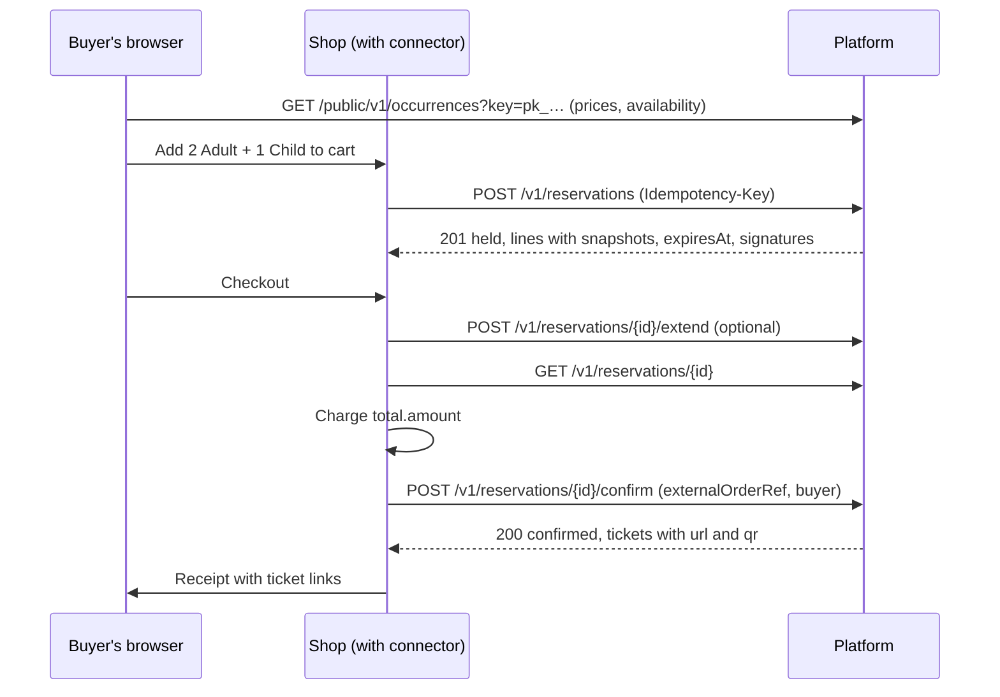

# Integration guide – selling tickets through your web shop and POS

*20 November 2026. For developers who connect a client's web shop, POS or ERP to the platform. Background: [docs/ticketing.md](ticketing.md), [docs/user-groups.md](user-groups.md), ADR [0007](adr/0007-api-contract.md) (the contract) and [0008](adr/0008-events-and-webhooks.md) (events). The OpenAPI documents are in [packages/sdk/openapi](../packages/sdk/openapi), and [packages/contract](../packages/contract) runs every flow in this guide against them.*

The platform owns everything **time-bound**: what is for sale, at what price, how many places are left, and who holds a valid ticket. Your shop owns everything about **money and the customer**: the cart, checkout, payment, receipt, customer record and refunds. Between them sits your **connector**, a small piece of server-side code that holds a secret channel key and calls the reservations API.

The platform takes no payments, sends no invoices and keeps no customer records beyond an optional buyer name and email per order.

## Contents

1. [Who owns what, stage by stage](#who-owns-what-stage-by-stage)
2. [Setting up](#setting-up)
3. [The web shop flow](#the-web-shop-flow)
4. [The POS flow](#the-pos-flow)
5. [User groups](#user-groups)
6. [Rules for every call](#rules-for-every-call)
7. [Reasons](#reasons)
8. [Signatures](#signatures)
9. [Things that happen without you](#things-that-happen-without-you)
10. [Going live](#going-live)

> **No web shop?** The platform's hosted checkout ([checkout.md](checkout.md)) sells tickets with Vipps MobilePay on the account's own merchant. It is a sales channel of kind `hosted`; this guide is for shops that connect their own channel.

## Who owns what, stage by stage

| Stage | The platform owns | Your shop owns | Calls |
|---|---|---|---|
| **Set-up** | Events, occurrences, offers (ticket types), prices, VAT classes, sales channels, SKU mapping, user groups | One thin product per SKU (e.g. `TICKET-VAT0`) in the shop and the ERP, with its VAT; nothing per event | Admin |
| **Browse** | Offers, names, prices incl. VAT, sales windows, availability (`available`, `few_left`, `sold_out`, `not_on_sale`) | The pages: layout, search, how events are presented | `GET /public/v1/occurrences`, `GET /public/v1/events/{idOrSlug}` |
| **Cart** | The **hold** (places kept for 15 minutes by default) and the **snapshot** per line: unit price, VAT class and rate, SKU, line name, start time, place | The cart, its id and its contents; the cart line points at the reservation line | `POST /v1/reservations` |
| **Checkout** | How long the hold lasts (`expiresAt`, at most 60 minutes in total) | The customer's details, delivery, the payment provider | `POST /v1/reservations/{id}/extend`, `GET /v1/reservations/{id}` |
| **Payment** | Nothing. Prices are never posted by the channel; the snapshot is what you charge | Charging exactly `total.amount`, receipts, fraud checks | — |
| **Order** | **Tickets**: one per unit, each with an admission, a QR code and a ticket page; the order reference | The order, its number, the full customer record | `POST /v1/reservations/{id}/confirm` |
| **Delivery** | The ticket pages and, if the channel's `sendTickets` is on, the tickets email | The receipt with the ticket links or QR codes (otherwise) | — |
| **Entry** | The admission: the QR payload is a signed admission token for the platform's validator app (ADR 0006, not built yet) | — | — |
| **Refund** | Cancelling tickets, voiding their admissions, putting the places back on sale, storing your refund reference | Deciding to refund, and refunding the money | `POST /v1/reservations/{id}/cancel` |
| **After the event** | Anonymising the buyer after the account's retention period; lines, prices, SKUs and order and refund references stay | The customer record and accounting, under your own retention | — |
| **Reconciliation** | Sold, cancelled and revenue per offer and group (Occurrence → Sales in the admin) | Matching orders and refunds to `externalOrderRef` and `externalRefundRef` | `GET /v1/reservations/{id}` |

Two consequences matter for every connector:

- **The platform decides the price.** Show prices from the public API, put the reservation's line prices in the cart, and charge `total.amount`. If the shop's own price differs, the snapshot wins.
- **The shop decides the money.** The platform never refunds anyone. If a confirm fails after the buyer has paid (see [`expired_sold_out`](#reasons)), your shop refunds them.

## Setting up

Staff do this in the admin, under Settings and on each event:

1. **VAT classes**, e.g. `exempt` 0 % or `reduced` 12 %, agreed with the client's accountant.
2. **Sales channels**: one per shop or till, e.g. `web` (`ecom`) and `pos` (`pos`), with a hold time (default 15 minutes) and `sendTickets`.
3. **SKU mapping**: one external SKU per (VAT class, channel), e.g. `exempt + web → TICKET-VAT0`. Create the same SKUs in the shop and the ERP as products with no price of their own. An offer whose VAT class has no SKU in a channel is not sold there.
4. **A channel key** per connector (`sk_<id>_<secret>`). It is shown once; store it as a server-side secret. It can only call `/v1/reservations` and read `/public/v1` for its channel. Keys can be revoked; deactivating the channel stops all its keys at once.
5. **A publishable key** (`pk_…`) for the shop's pages, which may be used in browsers.
6. **Offers** on each ticketed event, with their channels, VAT class, prices and sales window.

Base URLs: the core API serves `/v1`, the public API `/public/v1`. Both publish their OpenAPI document (`/v1/openapi.json`, `/public/v1/openapi.json`).

### The TypeScript SDK

`@event-manager/sdk` has typed clients generated from the OpenAPI documents. A connector uses `@event-manager/sdk/connector`:

```ts
import { createChannelCatalogClient, createChannelClient, verifyReservation } from "@event-manager/sdk/connector";

const api = createChannelClient({ baseUrl: "https://api.example.com", channelKey: process.env.CHANNEL_KEY! });
const catalog = createChannelCatalogClient({ baseUrl: "https://public.example.com", channelKey: process.env.CHANNEL_KEY! });
```

Connectors in PHP (Magento) or C# (Business Central, Optimizely) generate a client from the same documents.

## The web shop flow



### 1. Browse

The shop's pages read `GET /public/v1/occurrences?key=pk_…&event=<slug>` (or `/public/v1/events/{idOrSlug}`). Each occurrence lists its `offers` with `code`, localized `name`, `price { amount, currency, vatIncluded }`, `onSale`, `opensAt` and `closesAt`, and an `availability.status`. Amounts are in minor units (øre), VAT included. Responses are cached at the edge for 30 seconds, so treat availability as a hint; the reservation is the real check.

The connector may read the same endpoints with its channel key (`Authorization: Bearer sk_…`, server-side, never cached). It then sees only its channel's offers, each with its `sku`, `placesPerUnit`, `minPerReservation` and `maxPerReservation`, and `availability.placesLeft`.

### 2. Reserve when the cart changes

```http
POST /v1/reservations
Authorization: Bearer sk_…
Idempotency-Key: cart-42-v3
Content-Type: application/json

{ "externalRef": "cart-42", "locale": "en",
  "lines": [ { "occurrenceId": "…", "offerId": "…", "quantity": 2 },
             { "occurrenceId": "…", "offerId": "…", "quantity": 1 } ] }
```

- All lines are held, or none. One line per (occurrence, offer), 1–50 lines, and a reservation may span occurrences.
- The answer is `201` with `status: "held"`, `expiresAt`, `extendLimitAt`, `total` and one snapshot per line: `unitPrice`, `amount`, `currency`, `vatClassCode`, `vatRatePct`, `externalSku`, `name` (e.g. "Adult – Hamlet, Sat 13 Feb 19:30, Main stage", in `locale`), `occurrenceStartUtc`, `timezone`, `locationName`, `group`.
- Put the SKU, line name, unit price and quantity in the cart as they are. Keep the reservation id on the cart.
- **When the cart changes**, cancel the old reservation and reserve again. Reservations are not edited.
- When a line cannot be sold the answer is a problem with a reason and `details.line` (or `details.lines` for `sold_out`); show it next to that line.

### 3. Checkout

- If checkout takes long, call `extend` before payment starts: `{ "minutes": 30 }` moves `expiresAt` to 30 minutes from now, at most to `extendLimitAt` (60 minutes after the reservation was made). Extend checks the lines again, but not the price.
- **Before charging, read the reservation server-side** with `GET /v1/reservations/{id}`. It is the source of truth: charge its `total.amount`, and only if `status` is `held`. If the snapshot travelled through the browser, either read it again like this or check its [signatures](#signatures).

### 4. Confirm after charging

```http
POST /v1/reservations/{id}/confirm
Idempotency-Key: order-1042-confirm

{ "externalOrderRef": "ORDER-1042",
  "buyer": { "name": "Kari Nordmann", "email": "kari@example.com", "locale": "en" } }
```

- The answer is the reservation with `status: "confirmed"` and `tickets`: one per unit, in line order, each with `id`, `lineId`, `partySize` (the offer's places per unit), `url` (the ticket page with its QR code) and `qr` (the QR code's payload).
- Put the ticket links or QR codes on the receipt. With `sendTickets` on and a buyer email, the platform also emails them.
- `buyer` is optional personal data for the ticket page and the email. The shop keeps the full customer record.
- **A confirm must not be lost.** If the response does not arrive, retry with the same Idempotency-Key until it does; the retry returns the same tickets. Never reserve again for an order that has been paid.
- **Expired while paying.** A held reservation past `expiresAt` reads as `expired`, but can still be confirmed: confirm takes the places again if they are free. If they are not, the answer is `expired_sold_out` and nothing changes: refund the buyer.
- `schedule_changed`: staff moved the occurrence while it was held. Refund the buyer, or reserve again with their consent.

### 5. Refund

```http
POST /v1/reservations/{id}/cancel
Idempotency-Key: refund-77

{ "ticketIds": ["…"], "externalRefundRef": "REFUND-77" }
```

- Leave out `ticketIds` to cancel all valid tickets. Cancelled tickets' pages and QR codes stop working, their admissions are voided and their places go back on sale.
- The reservation stays `confirmed` while any ticket is valid and becomes `cancelled` with the last one.
- Tickets at an occurrence that has started cannot be cancelled (`occurrence_started`), unless the occurrence was cancelled.
- Refund the money in the shop first, then cancel here with the refund reference. If the cancel fails, the platform still counts the tickets as sold.

### 6. Abandoned carts

Cancel a held reservation without a body when the buyer empties the cart or leaves; its places are released at once. Otherwise they are released when it expires, within a minute of `expiresAt`. Held places count as gone in the public availability, so open carts can show an occurrence as sold out until they expire.

## The POS flow

A walk-up sale needs one call: reserve with `confirm: true` and the receipt number.

```http
POST /v1/reservations
Idempotency-Key: pos-7-receipt-311

{ "confirm": true, "externalOrderRef": "POS-7-311",
  "lines": [ { "occurrenceId": "…", "offerId": "…", "quantity": 1 } ] }
```

- The answer is `201` with `status: "confirmed"` and the tickets, priced with the POS channel's SKU. Print the QR codes or let the buyer scan the ticket link.
- If the till charges a card before the sale is recorded, use the web shop flow instead: reserve, charge, confirm.
- Refunds at the till are the same `cancel` call as in the web shop.
- Each channel sees only its own reservations. The web shop's orders cannot be refunded through the POS key, and the other way round; staff can cancel any order in the admin.

## User groups

The platform does not sign buyers in. Your site does, and the connector says which group the buyer belongs to. See [docs/user-groups.md](user-groups.md).

1. **Mirror your groups.** Staff create one user group per group your site has (members, students, sponsors), with the code your site uses. Codes never change.
2. **Show prices per visitor.** Read `/public/v1/occurrences?group=<code>` for a signed-in visitor, or read once without `group` and pick from each offer's `groupPrices`, falling back to `price`. Events and offers with `access.groups` are for those groups only; hide or lock them for other visitors.
3. **Reserve with the group**, from your server, after your own sign-in: `"group": "member"` on `POST /v1/reservations`. Lines are priced with the group's price and the code is frozen in each line and signed.
4. Expect `group_required` and `group_not_allowed` (with `details.line` and `details.groups`) and `unknown_group`.

The group is asserted, not verified: your channel key is the trust boundary. Never take the group from the browser without checking it against your own session.

## Rules for every call

- **Authentication.** `Authorization: Bearer sk_…` on every call. The key is a secret; never send it to a browser. An unknown or revoked key is `401 unauthenticated`; a deactivated channel is `403 forbidden`.
- **Idempotency.** Every write (reserve, extend, confirm, cancel) needs an `Idempotency-Key` header, 1–255 characters, unique per intended action, e.g. `order-1042-confirm`. Without one the answer is `428 idempotency_key_required`. A retry with the same key within 24 hours returns the reservation as it is now. The same key with a different body is `422 idempotency_key_reused`; a retry while the first request is still running is `409 idempotency_key_in_use`. Keys are kept per channel.
- **Retries.** Retry writes on timeouts, connection errors and `5xx`, with the same key and backoff. Do not retry `4xx` except `409 idempotency_key_in_use`.
- **Problems.** Errors are `application/problem+json` (RFC 9457) with a stable `code`, a `title` for logs and, where useful, `details`. Branch on `code`, never on `title`.
- **Money.** Integers in minor units (øre), VAT included; currency `NOK`.
- **Times.** UTC in ISO 8601. Show them in the occurrence's `timezone`.
- **Caching.** Reservation responses are `Cache-Control: no-store`. Public reads with a publishable key are cached for 30 seconds; with a channel key they are not cached.
- **Compatibility.** `/v1` only changes in ways that keep existing connectors working: new fields, new optional parameters, new reasons. Ignore fields you do not know, and treat an unknown reason like the others of its status. Breaking changes come in a new version with an overlap period.

## Reasons

The `code` of a problem. `details.line` is the index of the line in the request.

| Code | Status | When | What the connector does |
|---|---|---|---|
| `invalid_request` | 400 | The body or a parameter does not match the schema; `errors` lists the fields | Fix the request |
| `invalid_idempotency_key` | 400 | The Idempotency-Key is empty or longer than 255 characters | Fix the key |
| `unauthenticated` | 401 | No channel key, or an unknown or revoked one | Check the key |
| `forbidden` | 403 | The channel is inactive | Stop selling in this channel |
| `channel_not_allowed` | 403 | The offer is not sold in this channel (`details.line`) | Remove the line |
| `group_required` | 403 | The event or offer is for some user groups only (`details.line`, `details.groups`) | Ask the buyer to sign in, or remove the line |
| `group_not_allowed` | 403 | Not for the buyer's group (`details.line`, `details.group`, `details.groups`) | Remove the line |
| `not_found` | 404 | No such reservation for this channel, or no such occurrence or offer (`details.line`) | Reload the catalog |
| `sold_out` | 409 | Not enough places at an occurrence (`details.occurrenceId`, `placesLeft`, `places`, `lines`) | Show what is left |
| `not_on_sale` | 409 | The occurrence is not on sale, or the offer's sales window is closed (`details.line`, `opensAt`, `closesAt`) | Show when sales open |
| `offer_unavailable` | 409 | The offer is archived or not sold at this occurrence (`details.line`) | Remove the line |
| `no_sku` | 409 | The channel has no SKU for the offer's VAT class (`details.line`) | Ask staff to map the SKU |
| `expired` | 409 | Extend on an expired reservation | Reserve again |
| `extend_limit` | 409 | The hold cannot be extended further (`details.extendLimitAt`) | Finish checkout or reserve again |
| `expired_sold_out` | 409 | Confirm after expiry, and the places are gone (`details.occurrenceId`, `placesLeft`, `places`) | Refund the buyer |
| `schedule_changed` | 409 | The occurrence moved while held (`details.occurrenceId`, `reservedStartUtc`, `startUtc`) | Refund, or reserve again with consent |
| `already_confirmed` | 409 | Confirm for another order, or extend after confirm (`details.externalOrderRef`) | Use the existing order |
| `already_cancelled` | 409 | The reservation, or a listed ticket, is already cancelled (`details.ticketIds`) | Nothing to do |
| `occurrence_started` | 409 | A listed ticket's occurrence has begun (`details.occurrenceIds`, `ticketIds`) | Handle at the venue |
| `idempotency_key_in_use` | 409 | A request with this key is still running | Retry shortly |
| `quantity_out_of_range` | 422 | Fewer or more than the offer allows per reservation (`details.line`, `min`, `max`) | Adjust the quantity |
| `unknown_group` | 422 | No active user group has this code (`details.group`) | Check the group mapping |
| `validation_failed` | 422 | The request is well formed but not allowed, e.g. ticket ids on a held reservation (`details.field`) | Fix the request |
| `idempotency_key_reused` | 422 | The key was used for a different request | Use a new key for a new action |
| `idempotency_key_required` | 428 | A write without an Idempotency-Key | Send one |

## Signatures

Each reservation and each line carries a `signature`, so a connector can check a snapshot that came back through the buyer's browser (for example a cart stored client-side). Reading the reservation server-side with `GET /v1/reservations/{id}` needs no check, and is the simplest safe connector.

- **Key**: the SHA-256 of your channel key's secret, the part of `sk_<id>_<secret>` after the second underscore. Each response is signed for the key that asked, so only you can check it.
- **Algorithm**: `"v1." + base64url(HMAC-SHA256(key, text))`, without padding.
- **Line text**: the JSON array, without spaces, of

  ```json
  ["reservation_line.v2", reservationId, id, lineNo, occurrenceId, offerId, offerCode, quantity, placesPerUnit,
   unitPrice, currency, vatClassCode, vatRatePct, externalSku, name, occurrenceStartUtc, timezone, locationName, group]
  ```

- **Reservation text**: the JSON array of

  ```json
  ["reservation.v2", id, channelId, status, expiresAt, externalRef, externalOrderRef, totalAmount, totalCurrency, group, [lineSignature, …]]
  ```

Values are the response's own: strings as given, numbers as numbers, absent values as `null`. The reservation signature covers its status and `expiresAt`, so it changes on extend and confirm; the line signatures never change. `verifyReservation` in `@event-manager/sdk/connector` implements this. Compare signatures in constant time.

## Things that happen without you

- **Expiry.** Held reservations past `expiresAt` read as `expired` at once and their places are released within a minute.
- **Staff cancel tickets** in the admin (Occurrence → Sales), e.g. when a buyer calls the venue. The ticket gets `cancelledBy: "staff"`. The channel is not told yet: webhooks to channels arrive with epic #9. Until then, read open orders with `GET /v1/reservations/{id}` when reconciling, and refund in the shop when a ticket was cancelled by staff.
- **Cancelled or moved occurrences** keep their tickets; refunding is the shop's decision. Tickets at a cancelled occurrence can always be cancelled.
- **Price changes** after reserve do not touch held or confirmed reservations: confirm charges the snapshot.
- **Retention.** The buyer's name, email and locale are removed some months after the last occurrence (`anonymisedAt`); ticket links stop working. Lines, prices, SKUs and references stay.

## Going live

### Contract tests

[packages/contract](../packages/contract) runs this guide's flows (browse, cart, signatures, checkout, order, refund, abandoned cart, user groups, the POS sale and the reasons) through the SDK's connector client against the API, and checks every request and response against the OpenAPI documents. CI also fails on breaking changes to the documents against `main` (oasdiff). A connector in another language can check its own traffic against the same documents.

### Pilot checklist

No client has sold through a connector yet. Before the first one goes live, on staging:

1. Staff set up VAT classes, the `web` and `pos` channels, SKUs, keys and one ticketed event with at least two offers and a family ticket.
2. The shop creates the SKU products in the shop and the ERP, with the VAT the accountant agreed.
3. The connector passes, against staging:
   - [ ] a web order of 2 + 1 tickets, confirmed, with the ticket links on the receipt;
   - [ ] a retried confirm (drop the first response) that returns the same tickets;
   - [ ] a partial refund, then the rest, with refund references;
   - [ ] an abandoned cart released by cancel, and one left to expire;
   - [ ] a payment that outlasts the hold, confirmed while places are free;
   - [ ] `sold_out` and `quantity_out_of_range` shown next to the line;
   - [ ] a member price with `group`, if the client has user groups;
   - [ ] a POS walk-up with `confirm: true`, and its refund at the till;
   - [ ] tickets scanned at the door, once the validator app exists.
4. Finance reconciles one day's orders and refunds against Occurrence → Sales by `externalOrderRef` and `externalRefundRef`.
5. The client keeps the channel key in its secret store, and knows how to revoke it.
